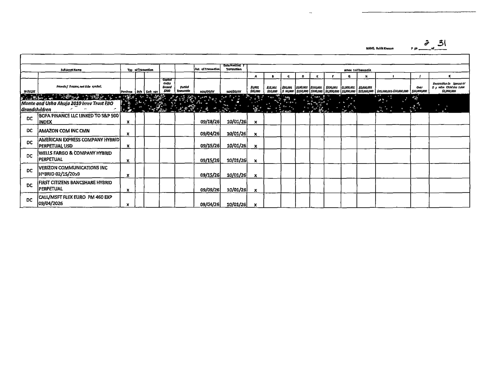

# Spike: member stock trades (House PTRs + Senate eFD)

**Verdict: GO.** Both chambers can be pulled with plain HTTP (no browser, no key), and e-filed trades parse at 100% field accuracy on 40 hand-checked House trades. The real risk is scanned paper filings: only 12.6% of House PTR filings, but 52% of their pages (1,298 of ~2,500), and two of the heaviest traders (Khanna, McCaul) file on paper. Plain OCR can't read the checkbox grids; a vision model read 32 of 32 scanned rows correctly in a small test. Without that step, the GENIUS Act join below is missing those members.

Run date: 2026-10-13. Data window: House PTR filings 2024-2026, Senate PTRs filed 2024-01-01 onward.

## What I measured vs the bar

| Metric | Value | Bar | Meets |
|---|---|---|---|
| House e-filed field accuracy, 40 random trades from 40 filings × 8 fields (filer, owner, asset, ticker, type, date, notified, amount) | 320/320 = 100% | ≥95% | yes |
| House trade-row completeness: parser rows vs an independent poppler `pdftotext` row count, all 1,209 e-filed PDFs | 13,872 = 13,872, 0 docs differ | match | yes |
| House PTR filings 2024-26 downloaded | 1,384/1,384, 0 failures | all | yes |
| Scanned share (DocID prefix 8/9 ⇔ no text layer, 100% agreement) | 175/1,384 filings = 12.6%; 1,298 pages | report | — |
| Plain OCR (RapidOCR) on a scanned page (Khanna p2, 7 rows) | dates 13/14, asset names readable but spaces lost, checkbox X marks 8/14 → type and amount unreliable | report | no |
| Vision LLM (Claude Sonnet via `claude -p`) on 3 scanned pages, 2 filers, incl. a rotated form | 32/32 rows, 191/192 fields match my reading; 1 smudged date (`09/1_/26`) was guessed as 09/11 | report | promising (small n) |
| Senate eFD access (terms POST + CSRF, plain HTTP) | 431/431 report pages fetched, 0 blocks, 250 ms between requests | reliable | yes |
| Senate electronic PTRs parsed (HTML table, structured) | 387 reports → 3,613 trades | — | yes |
| Senate paper PTRs (images) | 44 reports, all from 2 senators (Fetterman, Blumenthal) | report | needs vision step |
| GENIUS join: in-window trades in tied sectors | 707 trades by 65 members (41 R, 23 D, 1 I) | list | yes (minus paper filers) |

### Re-run

```sh
cd ~/Developer/antibody
bun spikes/trades/fetch-house.ts 2024 2025 2026                    # needs data/trades/idx/<year>FD.txt from the yearly ZIP
bun spikes/trades/fetch-senate.ts 01/01/2024 && bun spikes/trades/parse-senate.ts
systemd-run --user --scope -p MemoryMax=3G data/trades/.venv/bin/python -I spikes/trades/parse_house_all.py data/trades
python3 -I spikes/trades/count_check.py data/trades                 # parser vs poppler row counts
(cd data/trades && python3 -I ../../spikes/trades/sample_check.py house-trades.jsonl 7 handcheck-sample.json)  # the 40-trade sample, side by side with raw text
python3 -I spikes/trades/genius_join.py data/trades data/trades/out
```

The venv: `uv venv data/trades/.venv && VIRTUAL_ENV=data/trades/.venv uv pip install pdfplumber pymupdf rapidocr-onnxruntime`.

## How each piece works

```
House Clerk yearly ZIP ──► <year>FD.txt index (FilingType P = PTR, DocID)
        │                     DocID 2xxxxxxx = e-filed text PDF
        │                     DocID 8/9xxxxxx = scanned paper
        ▼
ptr-pdfs/<year>/<DocID>.pdf ──► pdfplumber words ──► per-page column x-ranges
                                (from the header row) ──► rows start where the
                                Type column has P/S/E and the Date column a date

efdsearch.senate.gov: GET /search/home/ → POST terms + csrf → POST
/search/report/data/ (report_types=[11]) → GET /search/view/ptr/<uuid>/ → HTML table
```

- **House e-filed PDFs** are clean once you parse by word position: column edges differ per page, so they're read from each page's header. Labels like "Filing Status" and "Subholding Of" render as glyphs that extract as `\x00`, which turns out to be a reliable marker for detail lines. Rows that run across a page break are joined.
- **Tickers** come from the last `(XXXX)` before the `[ST]`-style asset code, only for equity-like codes (ST, OP, EF…), so CUSIPs and fund names like "(GLAS Funds)" aren't read as tickers. 11,910 of 11,944 House stock rows have a ticker.
- **Values are kept exactly as filed**: some filers write exact amounts (`$360.00`) or a wrong year in the notification date. The parser keeps those as written, without "fixing" them.
- **Senate eFD** needed no headless browser. The bot wall is a Django CSRF token plus a terms checkbox; a cookie jar and a browser User-Agent get through. Every report page loaded.

## Sample output (facts, each with its filing)

| Member | Trade | Source |
|---|---|---|
| Rep. Tim Moore (R-NC) | bought COIN, $15,001-$50,000, 09/11/2025 | https://disclosures-clerk.house.gov/public_disc/ptr-pdfs/2025/20032256.pdf |
| Rep. French Hill (R-AR) | sold WFC, $15,001-$50,000, 06/23/2025 | https://disclosures-clerk.house.gov/public_disc/ptr-pdfs/2025/20030551.pdf (p.2) |
| Rep. Byron Donalds (R-FL), spouse | bought HOOD, $1,001-$15,000, 03/06/2025 | https://disclosures-clerk.house.gov/public_disc/ptr-pdfs/2025/20029092.pdf (p.5) |
| Rep. Gil Cisneros (D-CA) | bought HOOD, $1,001-$15,000, 07/09/2025 | https://disclosures-clerk.house.gov/public_disc/ptr-pdfs/2025/20030901.pdf (p.3) |
| Rep. Josh Gottheimer (D-NJ), joint | sold SQ (Block), $1,001-$15,000, 06/18/2024 | https://disclosures-clerk.house.gov/public_disc/ptr-pdfs/2024/20025419.pdf (p.3) |
| Sen. Dave McCormick (R-PA) | bought BITB, $50,001-$100,000, 02/25/2025 | https://efdsearch.senate.gov/search/view/ptr/ac293f74-570f-4c11-9224-79686a7500a9/ |
| Sen. Bernie Moreno (R-OH), S.1582 cosponsor | sold Bitcoin, $1,001-$15,000, 10/31/2025 | https://efdsearch.senate.gov/search/view/ptr/42ed7699-61fc-4a73-813d-4ae47af91e61/ |

## The GENIUS Act join

Bill: **S.1582, 119th Congress, GENIUS Act, P.L. 119-27** (confirmed from [BILLSTATUS](https://www.govinfo.gov/bulkdata/BILLSTATUS/119/s/BILLSTATUS-119s1582.xml); sponsor Sen. Bill Hagerty, 5 cosponsors). Key votes:

| Date | Event | Source |
|---|---|---|
| 2025-05-08 | Senate cloture on motion to proceed fails 48-49 | [vote 240](https://www.senate.gov/legislative/LIS/roll_call_votes/vote1191/vote_119_1_00240.xml) |
| 2025-05-19 | Senate cloture invoked 66-32 | [vote 262](https://www.senate.gov/legislative/LIS/roll_call_votes/vote1191/vote_119_1_00262.xml) |
| 2025-06-17 | Senate passes 68-30 | [vote 318](https://www.senate.gov/legislative/LIS/roll_call_votes/vote1191/vote_119_1_00318.xml) |
| 2025-07-17 | House passes 308-122 | [roll 200](https://clerk.house.gov/evs/2025/roll200.xml) |
| 2025-07-18 | Signed into law | BILLSTATUS |

Window: 2024-05-08 to 2026-07-18 (12 months before the first key vote, 12 months after signing).

**Inference, labeled:** a trade counts as "tied to the GENIUS Act" when the asset is in one of three sectors the law regulates or touches: crypto/stablecoin (COIN, HOOD, CRCL, MSTR, bitcoin ETFs, crypto assets), payments (PYPL, V, MA, XYZ/SQ, FI, AXP…), banks (JPM, BAC, C, WFC, GS, MS, BK…). That's a sector classification only, not evidence that a member acted on the bill or profited from it. Bonds, notes, structured notes and bank-branded funds are left out because they aren't equity exposure. Each member row carries their passage vote (from the roll call XML) and any sponsor or cosponsor role.

Result: **707 trades, 65 members** (House R 302 trades, House D 276, Senate R 118, Senate D 7, Senate I 4). 373 happened before the nearest key vote and 334 after. Top of the list:

| Member | Party | Chamber | Passage vote | Trades (buy/sell) | Sectors |
|---|---|---|---|---|---|
| Julie Johnson | D | House | Yea | 55 (13/41) | banks, payments |
| Josh Gottheimer | D | House | Yea | 52 (29/23) | banks, payments |
| Gil Cisneros | D | House | Nay | 51 (31/20) | banks, crypto, payments |
| Marjorie Taylor Greene | R | House | Nay | 36 (36/0) | banks, crypto, payments |
| Mike Collins | R | House | Yea | 36 (29/7) | crypto (ETH and other tokens) |
| Lisa McClain | R | House | Yea | 35 (18/17) | banks, payments |
| Jefferson Shreve | R | House | Yea | 34 (9/25) | banks, crypto (COIN, MSTR), payments |
| Val Hoyle | D | House | Nay | 30 (13/17) | banks, payments |
| David McCormick | R | Senate | Yea | 26 (24/2) | banks, crypto (BITB) |
| Jared Moskowitz | D | House | Yea | 25 (16/9) | banks, payments |

Full lists: [`out/genius-members.csv`](out/genius-members.csv) (one row per member, with every filing URL), [`out/genius-trades.json`](out/genius-trades.json) (every trade with its source URL, page, days from the nearest vote, and the inference label).

**Known gap:** paper filers are missing, among them Ro Khanna (906 scanned pages, about 19 trades per page), Michael McCaul (180 pages), Hal Rogers, Chuck Fleischmann, Tony Wied, Diana Harshbarger, and Senators Fetterman and Blumenthal (44 image reports). Khanna's pages alone may hold more trades than all e-filed House PTRs together, so the list above must not be read as complete until the vision step runs.

## Scanned filings



- Paper forms are checkbox grids: transaction type and amount are X marks in columns. OCR reads the text but drops about 40% of the marks and loses their column, so type and amount can't be trusted. Some pages are rotated 90° ([example](img/luna-scanned-rotated.png)).
- A vision model reading the page image returns the rows directly ([output](img/khanna-scanned-p2.vision.json)). Cost: about 1,300 House pages + 44 Senate reports, one call per page.
- Unreadable cells (a smudged digit) must stay marked as uncertain, never guessed. The test model guessed one, so the prompt needs an explicit `uncertain` field and a second read for those cells.

## Productionizing

1. **Ingest:** a nightly diff of the House yearly ZIP index and the Senate report list, fetching only new DocIDs and UUIDs. Senate: keep the request rate polite; no browser needed today.
2. **Parse:** the e-filed House parser as is (move to TS, or keep Python in a worker), the Senate HTML parser as is, and a vision-model extractor for scanned pages with per-cell confidence, a second-pass check, and human review for low-confidence cells. Store the page number with each trade so the UI can deep-link `#page=N`.
3. **Amendments:** House rows carry `Filing Status: Amended`, and Senate amendments are separate reports. They need to be deduped against originals (only 2 amended rows in the GENIUS hits).
4. **Member IDs:** House filings → bioguide by state+district+surname; Senate by surname (+ first name when ambiguous). 100% of filers matched here after handling suffixes (Jr., II) and "Former Senator" office strings.
5. **Company link:** the sector lists here are hand-made. Production should get beneficiaries from the entity-resolution lead (LDA clients, bill text), then ticker → CIK via EDGAR.

## Decisions for a human

- **Vision model for scanned filings?** Without it, Khanna, McCaul and others are invisible. My pick: yes, with an `uncertain` flag and a second read, and costs measured on 50 pages first.
- **What counts as "tied to the bill"?** I used a hand-written sector list. The fair, nonpartisan version is a rule applied the same way to every bill (for example, companies that lobbied on the bill plus companies named in its text), shown as an inference with that rule attached.
- **Spouse, dependent and joint trades:** show them under the member (the law requires disclosure because they're the member's interest), with the owner always visible?
- **Bonds and bank-branded funds:** excluded here. Include them as a separate, weaker tier?
